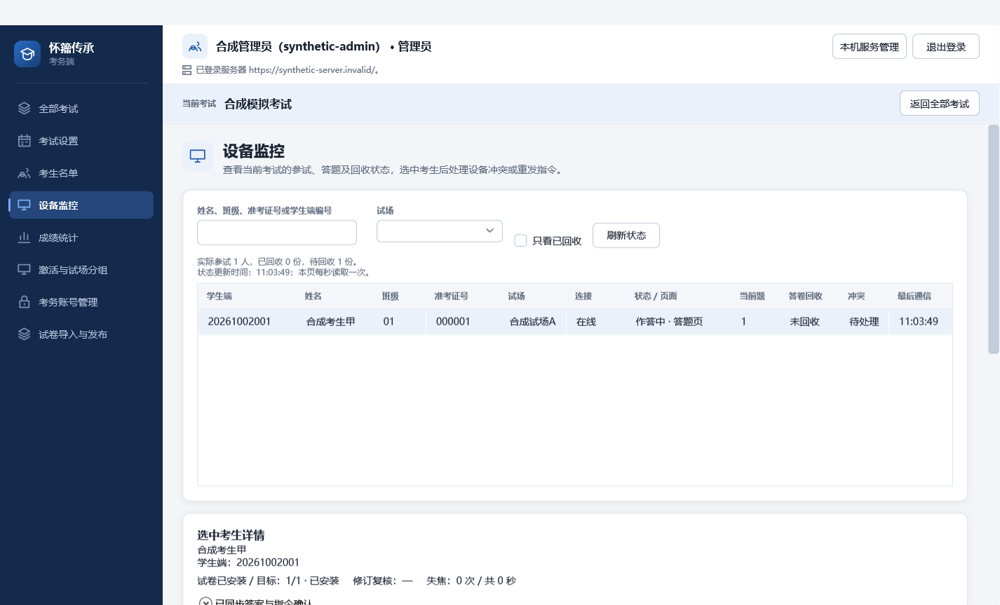
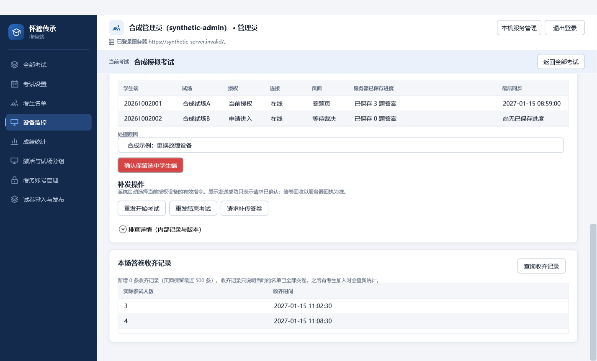

# C04 监控与补传操作

本页对应 #20 与 requirements.md「实时监测与回收」，修复审查清单 R1/R2/R3/R4/R6。主表按学生端编号、姓名、班级、准考证号与试场识别对象；答案、试卷更新、失焦与指令确认在选中考生后查看。内部标识和授权版本仅在折叠的排查详情中展示。

打开监控页立即读取现有 `/api/v1/exams/{examId}/monitoring` 权威快照，每秒串行刷新；离开、换考试、换服务器或关闭窗口取消查询。迟到响应不能替换新考试的数据，刷新保留选中考生、设备选择、原因与试场筛选。失联保留上次状态并明确标注，不能伪造在线或回收成功。每秒读取并不代表 300 人实测的两秒端到端延迟已经验收。

设备对照中的「最后同步」来自 `participation_progress.last_synced_at`，不是最后心跳；进度显示已保存的非空答案数，不显示内部答案版本。待裁决设备没有原设备进度时明确显示尚无已保存进度。裁决复用既有授权和版本检查，最终答卷仍不可覆盖。

重发开始与结束从当前快照选择 `CanResend` 的有效事件，由程序传递目标与授权。修正既有重发接口返回的 `CommandDelivery.deliveryAttempt` 与考务端 `CommandEventView.deliveryAttempts` 不一致的映射。

## 请求补传原答卷

增加定向的 `UploadRequested` 指令（追加枚举值，不改既有值），沿用可靠指令创建、持久化、重发、授权校验和确认通道。输入为当前参试记录、进入版本、授权设备及授权版本；不携带答案或解锁材料。服务器仅在考试结束或该考生已交卷后接受，并从已登录会话记录操作者；响应丢失重试保留原请求及事件标识。

学生端核对完整授权元组后通知既有 B05 同步服务立即重试，继续上传 B04 已固定的原答案与原提交标识；不解锁、不解冻、不生成新答卷。指令已处理不表示答卷已保存，考务界面一直以最终答卷回执判断回收。被撤权设备不能借此继续写入。

需要先在维护窗口执行 `202610041000_C04_upload_request.sql`，再同时部署更新的服务端与学生端。旧学生端不认识新增指令，不应在混合版本考场启用补传入口。回退应用前停止发送新增指令；保留已有指令和答卷记录，不删除数据、不恢复旧约束以免拒绝历史行。公共契约、指令授权与迁移需 A 审查，不能据此直接合并或关闭 #20。

## 本机开发验证（2026-10-04）

- .NET 10.0.401；锁定还原已执行；全解决方案 Release 构建 0 警告、0 错误。
- 考务非 WPF 305 项通过；WPF 42 项通过；单独截图测试 1 项通过，实际 App/MainWindow、合成 HTTP 依赖，覆盖八页、普通与最小窗口、1.00/1.25/1.50 位图渲染比例。渲染比例不等于真实 Windows DPI 设置验证。
- 核心单元测试（排除 Postgres/Latex）1564 项通过；初次隔离账户运行的临时监听/私钥检查失败，在正常用户环境重跑通过。
- 新用例覆盖活跃页刷新/离页停止、选择和原因保留、原请求补传重试、运行中不提前交卷、已失效授权拒绝、真实重发回执映射、设备已保存进度对照及迟到响应。
- 学生单元与身份测试，以及部分负载/接线测试被 Windows 应用控制以 `0x800711C7` 拒绝加载新编译程序集；正常用户环境重试仍受阻。未宣称这些测试通过。PostgreSQL 18、TeX、真实双机、断电恢复、300 会话与两秒监控指标尚未在本机执行；这些限制需在 A 审查前补齐相关模块检查，整场验收归 T01/T02。

截图内容全部是合成数据：

