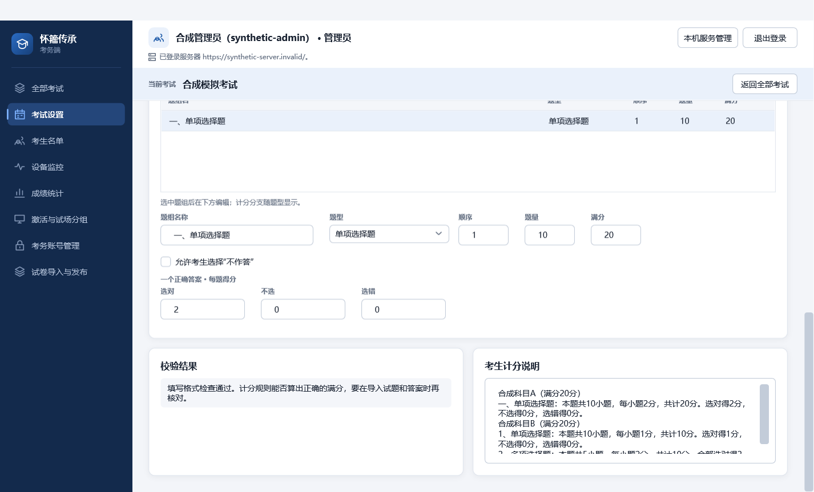

# C02 题组编辑与考试名称

对应审查 D2/D3 及 #18。题组概览只保留名称、题型、顺序、题量与满分；选中后在下方编辑规则。单项题只展示一个正确答案的分支，多项题只展示多个正确答案的分支，不定项题展示两种分支；隐藏不会清除原值。新增、删除、开考后的禁改规则、服务器校验及原计分契约不变。

requirements.md 明确不另设考试类别。学生考试卡片删除旧类别行，HTTP 展示模型忽略旧服务可能返回的类别；GUI 和 CLI 以唯一的考试名称选择考试，沿用服务器现有忽略大小写与首尾空格的唯一性约束。稳定内部标识继续由程序传递，保证更名不会改变参试、答卷和成绩关联。旧公共 metadata 契约与历史数据库列保留兼容，未迁移或删除历史数据；它们不再成为学生界面的独立业务字段。

本机验证：锁定依赖还原；.NET 10.0.401 全解决方案 Release 构建 0 警告、0 错误；考务非 WPF 测试 301 项通过；实际 App/MainWindow 的 WPF 绑定与题型切换冒烟 1 项通过，确认单/多答案适用分支可见性及编辑写回；独立合成截图测试 1 项通过。普通与最小窗口、100%/125%/150% 渲染位图已生成，其中题组编辑普通窗口截图已目视检查。渲染位图不等于真实系统 DPI 切换；学生程序集加载被 Windows 应用控制阻止，因此没有声称学生窗口现场验证通过。新增依赖、计分变更与数据库迁移均无。

