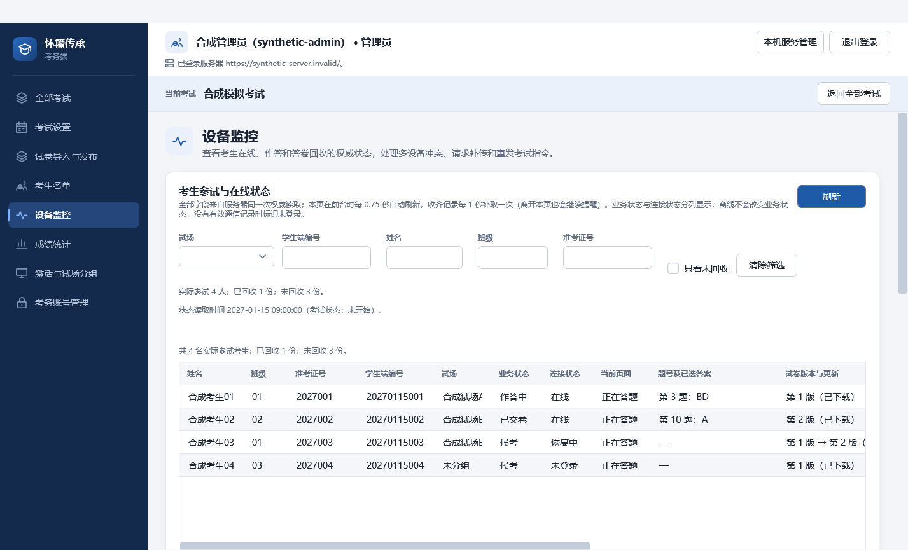

# PR #122 审查与本地验证（2026-10-05）

## 基线与范围

以已合并 #125 的 origin/main 为基线，在 #122 原分支合入该基线后审查。A 明确授权按 requirements.md 审查、修正和确认后合并；本轮由一个 Agent 完成，没有制造非作者批准。#46 保持打开。

## 发现与修正

1. 原 PR 只有考务显示，学生端从未调用设备状态接口。接通正式入口，页面、会话、答题状态、切出及本地保存失败触发上报；下载状态每 500 毫秒检查，不变状态每 60 秒补报。租约丢回执使用原请求重试，旧进程不能重新抢占新租约。
2. 原 2 秒监测周期没有留出学生上报及传输时间，收齐提示还要等待 20 秒。监测周期改为 750 毫秒、收齐记录周期为 1 秒；仍保持每个自动循环单请求，离开监测页不重启收齐循环。多版本收齐逐条排队提醒。
3. 原界面把 CurrentQuestionId 当题号。服务器从同一事务中的已发布试卷结构提供可空 CurrentQuestionNo；未知题号明确提示，内部标识不直接展示。样例和接口文档同步修改。
4. 设备状态关联同时核对考试、设备和考生会话，避免同一设备换考生后串行；最终答案优先读取固定答卷，不能用旧进度覆盖。
5. 原手动重发只更新投递计数，未立即推送；END 已确认后也无法请求补传。增加持久确认后实际推送的结果处理，允许对已结束、未回收、当前授权设备补传原 END。指令存储保留 Applied 确认，自动轮询仍不重复投递；学生端验证重复 END 后唤醒原固定答卷重试，不恢复编辑。
6. 监测刷新保留 WPF 的行选择及有效操作输入，移除失效指令和冲突设备；授权版本变化要求重新选择；较旧快照不覆盖新状态。裁决反馈显示公开编号或中性称呼，不透出内部设备标识。
7. 按 A 的追加要求，多项选择题和不定项选择题均将已选字母直接连写，例如 BD、ACD。监测页与成绩答案表（含 Excel 导出）统一去掉选项间分隔符，不改变答案存储或计分。

## 接口审查

核对学生 HTTPS 身份头与可信服务器校验、状态租约代次和序号、参试快照和候考状态、设备裁决版本、原指令重发回执、最终答卷固定标识及持久确认顺序。没有修改设备和考务的权限边界，没有修改计分、密钥或数据库迁移。公共 HTTP 契约增加可空题号，旧字段保留；页面状态增加切出和本地保存失败。

## 实际执行

Windows、.NET 10 Release、PostgreSQL 18 隔离临时实例。下列检查在本机实际运行，原始 TRX 与输出留在被忽略的 artifacts/pr122-review-20261005/ 下。

| 检查 | 结果 |
| --- | --- |
| dotnet restore Huaizhou.ExamSystem.sln --locked-mode | 成功，无依赖变化 |
| dotnet build Huaizhou.ExamSystem.sln --no-restore --configuration Release | 0 警告、0 错误 |
| 全解决方案核心测试，Category!=Postgres&Category!=Latex&Category!=Wpf | 2559 项通过：Unit 1567、Student 369、Identity 27、Admin 352、Integration 217、Load 27 |
| 最后文案与 GUI 修正后的 Admin 核心复测 | 352 项通过 |
| WPF，排除 Exam.AdminUnitTests.UiScreenshotTests | 63 项通过：Admin 42、Student 20、Identity 1 |
| Category=Postgres&Category!=PostgresPhysical&Category!=Latex | 213 项覆盖；第一轮 212 通过、1 项新增夹具失败，修正后 AdministrationApiTests 4 项全部通过，其他 209 项未重复运行 |
| 追加答案格式修改后的真实数据库报表接线 | Reporting_ 13 项通过，包含单选、多选、不定项的 HTTP 结果与 Excel 输出；多选和不定项均输出 BD |
| Python unittest discover -s tests/Tools -p test_*.py | 25 项通过 |
| 实际 WPF 合成界面捕获 | 8 个业务页及登录、管理入口等页面，100%/125%/150%，绑定日志为空；直接查看监测截图 |

新增接线检查包括学生正式 HTTP 传输、租约回执丢失与 60 秒补报、旧进程拒绝、真实数据库状态上报到监测 HTTP 查询、迟到序号拒绝、实际题号、手动 END 的持久确认失败不推送、原确认不可覆盖、重复 END 保留固定答卷标识，以及 WPF 刷新保持有效选择。

测试过程中没有隐瞒失败。初次核心检查发现页面切换重启收齐循环，以及已确认 END 的存储拒绝手动投递，两处均修正并复测。新增 WPF 用例曾错误要求保留不可重发指令，改为验证有效指令；裁决反馈断言随隐藏内部标识同步改为核对新原因。新增 PostgreSQL 夹具最初使用多条预编译 SQL，改为单条 CTE 写入后 HTTP 接线 4 项通过。

追加报表用例曾因目标类型为只读字典而编译失败，改为显式创建字典后 Release 构建恢复为 0 警告、0 错误，上述 13 项通过。选项连写后另复测 Admin 核心 352 项通过，并重新捕获、查看 BD 监测截图。

首次运行既有 WPF 套件时一并执行了截图摘要去重用例；发现后，后续排除该用例并使用直接截图检查。未额外进行源码或发布包哈希检验。

## 边界与恢复

GitHub CI 因账号计费限制没有启动，不能写作 CI 通过。必要模块检查由本地执行替代。没有运行不受本次改动影响的 TeX 编译、整包重复构建对比或主备物理恢复；300 人多机现场网络延迟与故障恢复仍属 T01/T02，模块通过不等于现场验收。

服务端应先更新，再更新学生端和考务端，确保新增页面状态可被识别。无数据库迁移，回退采用回退本次代码提交；原答卷、原指令确认和既有回执保持保留，不清库、不重置考试。
