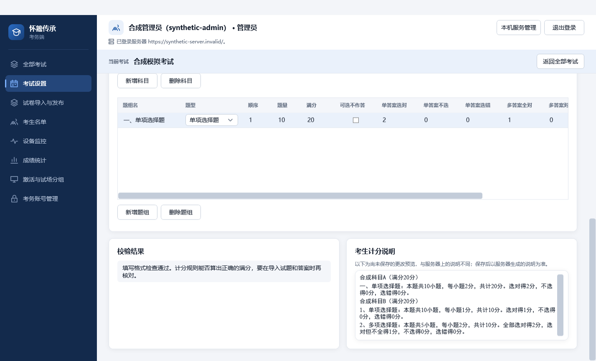
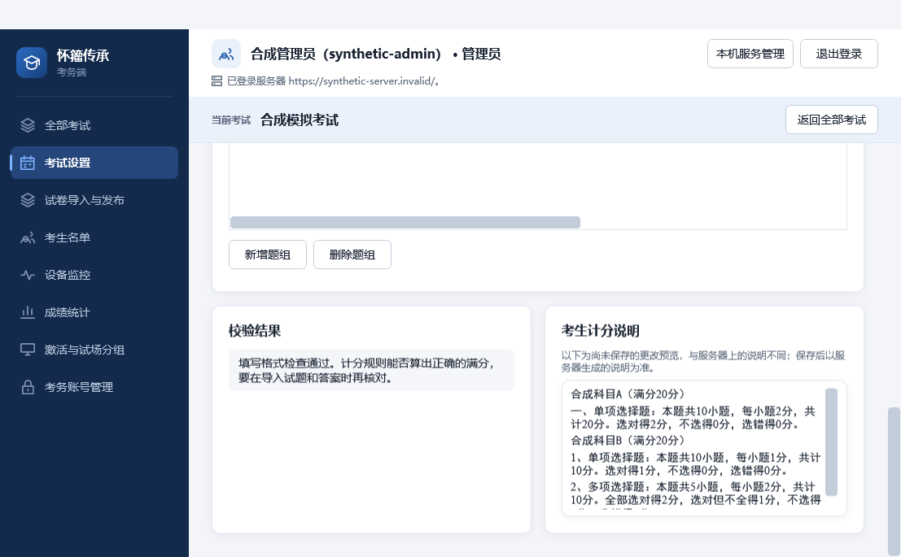

# PR #123 审查与本地验证（2026-10-05）

## 需求与接口
以 #122 合并后的 origin/main（dc470de）为基线，保留 #125 的按钮说明、题组操作位置和导航。按 requirements.md 的结构化计分说明、字体与现有考试设置接口审查。A 授权本轮修正、验证及合并，未制造非作者批准。

说明文字读取 ExamDetail.InstructionLines，数据库来源为 student_exam_instructions 当前版本；学生端读取同一说明资源，但离线学生不一定已收到。因此界面表述为“服务器保存、供学生端读取”，不宣称所有学生当前均已显示。草稿和服务器副本分开，切换考试或服务器时清空旧说明；没有说明时明确显示本地预览。

## 修正
- 原 WrapPanel 将中文和数字排成独立文本块，长句在分段边界断行。改为同一 TextBlock 内的 Run，正文黑体、数字 Times New Roman，自然换行且不改文字。
- 原响应检查只覆盖最外层，缺失科目或题组会在应用设置过程中出错。补充嵌套结构检查和更新回执的考试身份检查。现有服务端会为尚无考试目录设置的旧考试返回空科目数组，该兼容路径保留，不能用新建考试的业务校验拒绝读取。
- 写入回执损坏或通信失败时，明确提示无法确认保存结果、重新读取核对，不声称服务器未保存。
- 本地回归暴露两处既有测试时序问题：慢请求测试固定等待 600 毫秒，改为有界等待第二轮实际请求；补传计数测试在非 GUI 线程读到刷新中间态，改为显式驱动权威读取，并增加指令回执不等于答卷收齐的断言。自动刷新仍由专门用例与真实 WPF 绑定检查覆盖。

## 实际验证
Windows/.NET 10 Release。记录保存在被忽略的 artifacts/pr123-review-20261005/。

| 检查 | 结果 |
| --- | --- |
| dotnet restore Huaizhou.ExamSystem.sln --locked-mode | 成功 |
| dotnet build Huaizhou.ExamSystem.sln --no-restore --configuration Release | 最终 0 警告、0 错误 |
| 全解决方案核心，Category!=Postgres&Category!=Latex&Category!=Wpf | 已执行；首轮两项失败，见下文。Student 369、Identity 27、Integration 217、Load 27 全部通过 |
| 修正后的 Admin 核心复测 | 最终 366 项全部通过 |
| Unit 模块复测 | 1567 项全部通过 |
| WPF，排除 Exam.AdminUnitTests.UiScreenshotTests | Admin 42、Student 20、Identity 1，共 63 项通过 |
| PostgreSQL 18 临时隔离实例，PostgresExamCatalogTests | 7 项通过，包含设置与说明持久化、读取及重试幂等 |
| 实际 WPF 预览 | 普通与最小窗口、100%/125%/150% 合成截图；绑定日志为空，直接查看窄窗口排版 |

失败如实记录：首轮核心的慢刷新固定延迟断言失败已按上述修正；同轮 CompilationProcessLimitsTests 在删除临时目录时遇到文件占用，目标用例 2 项及完整 Unit 1567 项分别复测通过，未修改无关外部进程实现。后续 Admin 复测暴露补传测试线程竞态，修正后完整 366 项通过。不能把这些记录写成全套首次通过。

## 范围与恢复
没有改变计分计算、数据库、契约、权限、密钥或答卷保存。CI 因计费限制不能启动，必要检查在本机实际执行；本次无 TeX 编译、主备或多机网络改动，不重复这些外部检查。#46 保持打开；不代表 T01/T02 或整体交付通过。可回退本 PR 的界面及客户端代码，服务器已保存说明不需清除或迁移。
