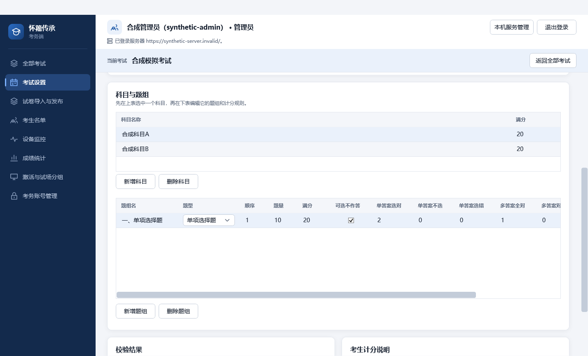
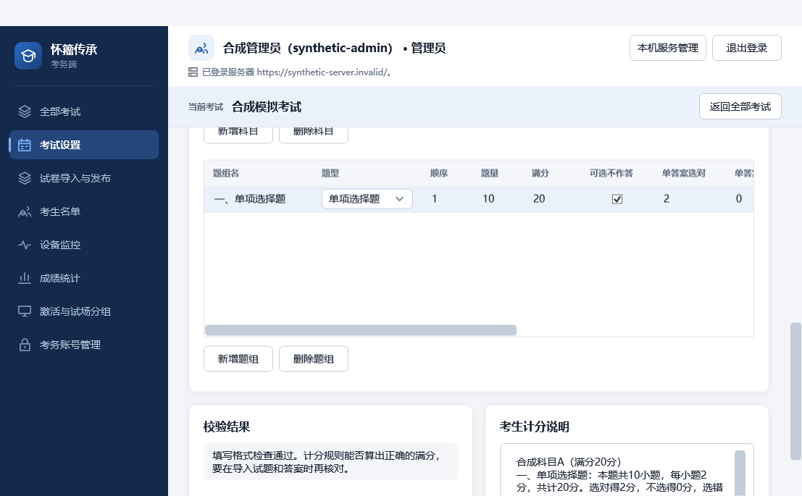

# PR #125 审查与本地复测

审查依据为 requirements.md、现有客户端和服务端接口，以及 A 在本次对话中明确要求的界面调整。A 已授权 Codex 审查、修正并在检查通过后合并。本记录由 Codex 执行形成，不冒充另一位成员的批准。

## 审查范围和结论

逐项检查 PR 的全部源码差异、测试和合成截图，涵盖考试设置说明、导航顺序、设备目录查询、导入页格式说明、本机服务管理标签及题组编辑区。未发现尚未修复的代码或接口阻断问题。

- 考试设置的校验、保存、重新读取仍绑定各自原有命令。说明区完整显示为一行，重新读取会覆盖未保存内容的行为已写明。
- “试卷导入与发布”位于考试设置和考生名单之间。页序号及从本机服务管理返回监控、统计的激活判断同步调整，避免启动错误页面的后台刷新。
- 设备目录只在明确查询时应用输入条件。首次读取取全部设备，手动重新读取清空条件并取完分页；自动刷新保留最后成功应用的条件，输入框里的草稿不会悄悄改变结果。新增回归覆盖成功查询后编辑条件期间的自动刷新。
- 检查了设备目录对服务器连接切换、迟到响应、分页不前进、重复身份、版本冲突和失败回执的处理。查询仍用 null 表示全部试场，空字符串表示未分组；没有改变服务端权限、版本或写入语义。
- 批量转组完成后的内部刷新继续使用已应用筛选。失败不把旧目录当成可写的新状态，连接改变清除旧查询及设备信息。
- 导入说明与 ExamImportWorkspace、ImportPipeline 和逐题导入包规范一致。目录或 ZIP 必须含根清单、完整独立答案、逐题 TeX 和被引用资源。更名后的下载按钮仍使用原有材料下载命令。
- 本机服务管理四处标签仍分别绑定地址、系统标识、节点标识和原密码框；登录及身份核对逻辑未改。
- 题组新增和删除按钮已移到题组表格下方。“允许不答”改为“可选不作答”，七个计分表头均移除中间圆点。复选框和计分列的字段绑定未改，不涉及计分规则变更。

## 本地验证

环境为 Windows、.NET SDK 10.0.401。按仓库要求执行锁定依赖还原及 Release 构建，结果为 0 警告、0 错误。

在 CI 无法启动的情况下，直接运行流水线使用的核心和 WPF 筛选范围，并补跑工具检查。保留本地 TRX，不执行额外的源码或截图摘要比对。

```powershell
dotnet restore Huaizhou.ExamSystem.sln --locked-mode
dotnet build Huaizhou.ExamSystem.sln --no-restore --configuration Release
dotnet test Huaizhou.ExamSystem.sln --no-build --configuration Release --filter 'Category!=Postgres&Category!=Latex'
dotnet test Huaizhou.ExamSystem.sln --no-build --configuration Release --filter 'Category!=Postgres&Category!=Latex&Category!=Wpf'
dotnet test tests/Unit/Exam.AdminUnitTests/Exam.AdminUnitTests.csproj --no-build --configuration Release --filter 'Category!=Postgres&Category!=Latex&Category!=Wpf'
dotnet test Huaizhou.ExamSystem.sln --no-build --configuration Release --filter 'Category=Wpf'
python -m unittest discover -s tests/Tools -p 'test_*.py'
git diff --check
```

最终分模块复测结果为核心 2525 项通过，WPF 64 项通过，工具检查 25 项通过，均无失败或跳过。核心包含 Unit 1566、Student 368、StudentIdentity 24、Admin 324、Integration 216、Load 27；WPF 包含 Student 20、StudentIdentity 1、Admin 43。WPF 筛选独立运行，包含常规排除外部类别的整仓库筛选未选中的界面用例，因此不将不同范围直接冒充一次整仓库检查结果。

另使用本机 PostgreSQL 18 新建仅监听回环地址的隔离临时实例，按 CI 数据库筛选运行 `Category=Postgres&Category!=PostgresPhysical&Category!=Latex`，211 项通过、0 失败、0 跳过，用时 2 分 13 秒。运行结束已停止该实例并清理其自有临时目录，没有使用或修改现有数据库。连接凭据只在子进程环境中传递，未提交。独立的真实 TeX、导入端到端、物理恢复和重复打包比对未执行，本 PR 不改这些模块；各业务模块及 WPF 接线的必要检查已在本地完成。

GitHub Actions 由于账号付款或支出额度问题无法启动。A 已明确要求由 Codex 在本地完成必要检查，并授权审查修正后合并。云端未运行的状态仍如实保留，不将本地成功伪称为云端成功。

### 首次失败与复测记录

本次并非一次性全绿。首次常规检查为 2587 通过、1 失败，失败发生在 CompilationProcessLimitsTests 的临时目录清理，被 Windows 报告仍有进程占用。该测试两个资源限制场景单独复测均通过，随后整个 Unit 核心 1566 项通过。复核 ExternalProcessRunner 已终止进程树并等待退出，没有为让检查通过而删去资源限制断言。

第二次核心筛选中，考务导入材料下载用例在断言目标文件存在时失败。该用例单独复测通过，随后整个 Admin 核心 324 项通过。原失败日志和后续结果分别保留于 artifacts/pr125-review-20261005，没有改写首次结果，也没有放宽文件存在断言。两次失败在复测中未再次出现，不能据此声称所有机器上的偶发文件占用已经消除。

### GUI 证据

用生产 WPF 页面与合成夹具渲染普通及最小窗口，检查两个按钮的实际纵坐标在题组表格底部之下，检查表头名称及绑定错误日志。截图过程中数据绑定错误日志为空，中文显示完整。





## 边界与回退

本次未更改公共契约、服务端、迁移、权限、答案持久化或计分逻辑。可整体撤销 PR 恢复原 GUI 与查询行为，无数据格式迁移。本次属于开发期审查，不能代替 T01/T02、多机、断电恢复或 300 人考试验收。#46 的其它未完成事项不因本 PR 合并而关闭。
