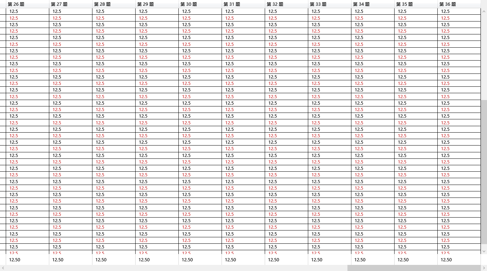

# PR #75–#80 联合审查、修正与任务收尾

审查日期：2026-09-29。按项目所有者本轮授权对当时全部6个开放PR进行代码审查、接口检查、负面测试、修正、回归和合并，并按“非T卡开发完成即可关闭”清理任务边界。需求基线为requirements.md；不改变T阶段的真实环境验收门槛。

## 已合并版本与远端检查

| PR | 审查并合并的源分支HEAD | 合并提交 | 最新源分支检查 |
| --- | --- | --- | --- |
| [#75](https://github.com/yeyiwen2006/huaizhou-exam-system/pull/75) | `b28bf780cc9e` | `de9d67add0ee` | [build-test](https://github.com/yeyiwen2006/huaizhou-exam-system/actions/runs/36472063815/job/109096511516) / [postgres-integration](https://github.com/yeyiwen2006/huaizhou-exam-system/actions/runs/36472063815/job/109096510945) |
| [#76](https://github.com/yeyiwen2006/huaizhou-exam-system/pull/76) | `8f4f0eb1e3af` | `0feeec3845c4` | [build-test](https://github.com/yeyiwen2006/huaizhou-exam-system/actions/runs/36383068600/job/108802656647) / [postgres-integration](https://github.com/yeyiwen2006/huaizhou-exam-system/actions/runs/36383068600/job/108802656446) |
| [#77](https://github.com/yeyiwen2006/huaizhou-exam-system/pull/77) | `128b90056d64` | `0edcba2f71ba` | [build-test](https://github.com/yeyiwen2006/huaizhou-exam-system/actions/runs/36472074233/job/109096546603) / [postgres-integration](https://github.com/yeyiwen2006/huaizhou-exam-system/actions/runs/36472074233/job/109096546822) |
| [#78](https://github.com/yeyiwen2006/huaizhou-exam-system/pull/78) | `c066da61b8c5` | `c82e95b2f73a` | [build-test](https://github.com/yeyiwen2006/huaizhou-exam-system/actions/runs/36472084293/job/109096580603) / [postgres-integration](https://github.com/yeyiwen2006/huaizhou-exam-system/actions/runs/36472084293/job/109096580434) |
| [#79](https://github.com/yeyiwen2006/huaizhou-exam-system/pull/79) | `f467236b263d` | `f7a747a28b5c` | [build-test](https://github.com/yeyiwen2006/huaizhou-exam-system/actions/runs/36472091911/job/109096602637) / [postgres-integration](https://github.com/yeyiwen2006/huaizhou-exam-system/actions/runs/36472091911/job/109096603501) |
| [#80](https://github.com/yeyiwen2006/huaizhou-exam-system/pull/80) | `7cc374f2a215` | `5b63a6c2a1c6` | [build-test](https://github.com/yeyiwen2006/huaizhou-exam-system/actions/runs/36445695008/job/109011131738) / [postgres-integration](https://github.com/yeyiwen2006/huaizhou-exam-system/actions/runs/36445695008/job/109011134494) |

六个PR合并后的main为`5b63a6c2a1c61cce85cd1130da30e2f899098add`。与本地执行完整最终测试的审查提交`d1345953960cf452c77fd538f7b95bb10503da0d`进行Git树内容比较，差异为0。源分支保留原作者历史，修正以增量提交推回，未force push、未直接推main、未绕过失败检查。A自己的PR只写实际审查评论，不制造非作者批准。

## 发现、修正与回归

| 范围 | 原代码问题和实际修复 |
| --- | --- |
| G02 Excel精度 | `decimal.TryParse`会先舍入30位长小数，原来的回读比较可能把已损失的精度误认成可写数字。先检查原始有效位数，超过Excel保守精度则保留精确文本；`100000000000000.000000000000001`等失败例已转绿。 |
| G02 原始文本 | ClosedXML消耗一个开头单引号，导致`'literal`变成`literal`。只对真实开头单引号转义，保留完整原文；`= + - @`开头的文本仍不是公式。 |
| G02 工作表名 | 按31个UTF-16代码单元截断可能切开代理对并导致保存抛错；现避开截断高代理项，保留唯一后缀和长度约束。 |
| G03 结果投影 | null均值原显示空白，现为“无有效样本”；均分对应排名仍为空。 |
| G03 WPF布局 | 原最右列结束于4801而内部纵滚条从4782开始，实际遮住成绩。现预留纵滚条宽度并消除列对齐边框偏移；真实WPF验证横向滚动、固定均分行、首四列合并、最右列完整及失效清空。 |
| C04 历史收齐 | 旧逻辑只记id/version，跨请求或重连后的同id内容改变、同版本不同id会被当成正常结果；0参试事件也能提醒。现按serverId/examId保存完整事件并整页先验，冲突不推进游标、不污染列表，不发假提醒。 |
| D03 安全发布 | 原Publisher在Builder边界校验前读取越界PDF，且提前取消没有传播。现于解析前验证路径/链接、导入清单一致性、精确编译集合与成功状态、文件总容量，抽取前后检查取消。发布必须指定密文目标和接收节点；明文预览明确使用Builder。 |
| G01 #76 / C05 #80 | 保留作者实现：独立300条合成共同样本/输入快照回归，以及导入源清单与学生清单v1/v2的误选拒绝。未发现需修改代码的缺陷，不制造无意义改动。 |

本轮先新增23个测试实例验证疑点，其中17个在原生产代码上失败、6个通过；修复后23个全部通过。随后再补10个发布输入/容量/加密边界实例，全部通过。总计新增33个实例，没有删除失败用例、放宽断言或延长故障断言预算来换取通过。一次新增测试的字段名编写错误已在测试编译阶段修正，不计作产品缺陷或业务测试失败。

无TeX依赖的Publisher负面用例从整个类的Latex分类移回普通CI，只将真实编译用例保留为Latex。这使原普通/Latex数量发生1个用例迁移，总用例没有丢失。

## 实际全量验证

环境：独立Windows副本、.NET SDK 10.0.401、真实TeX Live XeLaTeX、专为本轮创建的回环PostgreSQL 18实例。全部数据为合成夹具；未读取真实试卷、真实账号/成绩或业务数据库。数据库随机认证只在测试进程环境中使用，测试结束后停止隔离实例。

| 检查 | 原组合基线 | 修正后最终 |
| --- | ---: | ---: |
| 非Postgres / 非Latex / 非Wpf | 1649 | 1679 |
| WPF真实控件/学生PDF模块 | 19 | 23 |
| 真实XeLaTeX与发布读取链 | 25 | 24 |
| 真实PostgreSQL集成 | 78 | 78 |
| 合计通过 | **1771** | **1804** |
| 失败 / 跳过 | **0 / 0** | **0 / 0** |

锁定依赖还原通过，最终全解决方案Release构建0警告、0错误；Git差异检查通过。各组由TRX程序汇总，不把无匹配用例的测试项目计为跳过。已存在的适用并发、幂等、事务、恢复和失败边界用例均随全量组执行。

```powershell
dotnet restore Huaizhou.ExamSystem.sln --locked-mode
dotnet build Huaizhou.ExamSystem.sln --configuration Release --no-restore
dotnet test Huaizhou.ExamSystem.sln -c Release --no-build -m:1 --filter "Category!=Postgres&Category!=Latex&Category!=Wpf" --logger trx
dotnet test Huaizhou.ExamSystem.sln -c Release --no-build -m:1 --filter "Category=Wpf" --logger trx
dotnet test Huaizhou.ExamSystem.sln -c Release --no-build -m:1 --filter "Category=Latex" --logger trx
# EXAM_TEST_POSTGRES仅指向独立合成测试实例，不连接业务库。
dotnet test tests/Integration/Exam.IntegrationTests/Exam.IntegrationTests.csproj -c Release --no-build --filter "Category=Postgres" --logger trx
```

原始构建日志、红/绿回归TRX、两轮分组TRX、Git树比较与GitHub操作前后JSON保存在本机仓库外的`huaizhou-pr-audit-20260929/records/`。不将数据库、口令、原始本机日志或可重建运行包提交到仓库。

## WPF合成布局证据

新控件测试在实际STA线程和WPF窗口中渲染40列/60行合成表格，模拟1366×768像素下100%、125%、150%的逻辑视口/渲染比例。检查列/滚条几何、纵向滚动时均分行固定、横滚到底和清空行为。**这是控件模块测试，不是修改物理显示器DPI，也不代替目标设备现场验收。** 截图只包含合成行、合成成绩。



[125%合成视口](images/pr77-review-125.png) · [150%合成视口](images/pr77-review-150.png)

设置测试环境变量`EXAM_REPORT_SCREENSHOT_DIRECTORY`可在自己的隔离目录重新输出截图；未设置时测试不写截图文件。

## 任务收尾决定与仍保留的开发缺口

按[开发卡关闭规则](../development-closure-policy.md)同步全部非T任务正文和活动状态。B03 #11、B04 #12、B05 #13、D03 #26、D04 #27按所属模块开发完成关闭。E04 #35的可复用发布工具归E01 #30，候选包汇总/重建归T01 #33/T02 #34，最终交付归T03 #48；#35按范围移交关闭为not planned，不冒充已产出整包。

B06 #14失焦持久化/补报、服务端已阅闭环和变更题目定位；B07 #15发布配置；F01-F05的真实宿主/主备/运维接线；C05 #21实际导入发布；D05 #28生产后台与重算接线；D06 #29材料对照及CLI；G01/G02/G03的权威读取、开放门、业务API/CLI、导航与实际导出；C01-C04 #46完整配置/名册/试场/实时监测等仍为明确软件待办。这些卡不会仅因纯函数、控件或一个子PR合并而关闭。

原关闭的A/B基础任务和D01/D02保持关闭，#17-#20作为并入#46的重复任务保持关闭，清掉与关闭状态矛盾的活动标签。T01/T02/T03保持打开和原验收标准，仅接收候选包阶段工作，不将本轮自动检查记成T阶段通过。按该映射收尾后目标为18张开放卡（15张真实开发卡、3张T阶段卡）。

## 接口、风险与未执行范围

D03发布调用方必须独占导入/编译工作目录直到抽取及组包结束，不宣称对并行恶意文件改写提供事务快照。Publisher新增入口的消费接线归C05；主备异机解锁归F02。没有修改数据库迁移、既有计分规则或已持久答卷/回执语义。

20秒历史收齐补取不等于实时监测/2秒通知。纯报表结果与写入器不等于具备生产授权的报表发布，相关卡保持打开。正式T01全项目单机验收、T02真实双机/独立负载机/网络故障/断电、300客户端完整时长、真实最大材料包与物理DPI，以及T03全部产物固定和移交均未执行。原Sxx及性能门槛不变。

需要回退时以新的revert PR恢复相应代码，保留原作者与修正历史，不强推共享分支；治理规则修订也通过PR留痕，不删除问题讨论。
